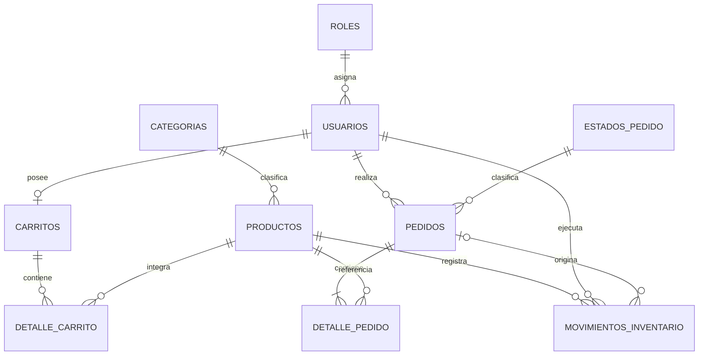

# JORNADA 07 — Base de datos SQL Server

**Proyecto:** Dulce Hogar / ReposteriaWeb  
**Autor:** Oscar Armando Medina Gutiérrez  
**Materia:** Verificación y Validación de Software  
**Fecha:** 19 de noviembre de 2026

## 1. Objetivo y alcance

Crear la persistencia relacional del sistema en SQL Server Developer mediante SSMS. Esta jornada no conecta React ni reemplaza la autenticación simulada. La API, hashing de contraseñas, autorización y transacciones de negocio se implementarán en jornadas posteriores.

## 2. Preparación

Desde Git Bash, en `/c/6to/reposteria-web`:

```bash
git status
mkdir -p database docs
```

Guarda este documento como `docs/JORNADA_07.md`. Si la jornada anterior tiene cambios pendientes, compílala y regístrala por separado antes de continuar.

Abre SSMS, selecciona Database Engine y Windows Authentication. Usa el nombre de tu instancia instalada (por ejemplo `localhost`, `.` o `localhost\\NOMBREINSTANCIA`, según tu configuración; escribe una sola barra invertida). Si hay un error de certificado, en un entorno local de desarrollo puedes habilitar Trust server certificate; no es una recomendación para producción. Ejecuta `SELECT @@VERSION, SERVERPROPERTY('ServerName');` en New Query para verificar el servidor.

## 3. Modelo entidad-relación



Las relaciones separan entidades y evitan listas repetidas en columnas (1FN), dependencias parciales en detalles (2FN) y duplicar nombres de categorías o roles (3FN). El precio histórico es un dato propio de la línea del pedido, no una copia que deba actualizarse con el precio actual. El subtotal calculado evita inconsistencias aritméticas. El total del pedido se obtiene mediante una vista.

Decisiones propuestas: un rol y un carrito por usuario; catálogo con baja lógica; cinco estados incluyendo Listo para entrega; importes DECIMAL, fechas UTC, existencias enteras. Los movimientos forman una bitácora; el stock actual se guarda en Productos y deberá actualizarse atómicamente junto con esa bitácora. No se eliminan pedidos históricos. No se incorpora pago en línea ni direcciones de envío sin requisitos confirmados.

## 4. Crear esquema

**Ruta:** `database/01_esquema.sql`. Copia el bloque completo a ese archivo y ejecútalo desde SSMS (File > Open > File, Execute/F5). Está diseñado para una base nueva: si ya existe, detente y revisa su contenido; no borres datos para volver a ejecutarlo.

```sql
-- Nombre: Oscar Armando Medina Gutiérrez
-- Materia: Verificación y Validación de Software
-- Programa: 01_esquema.sql
-- Descripción: Crear la base de datos y sus restricciones.
-- Requerimiento: RF01-RF20 (soporte de persistencia)
-- Fecha: 19 de noviembre de 2026
USE master;
GO
CREATE DATABASE DulceHogar;
GO
USE DulceHogar;
GO
SET XACT_ABORT ON;
BEGIN TRANSACTION;
CREATE TABLE dbo.Roles (
  idRol INT IDENTITY PRIMARY KEY,
  nombre NVARCHAR(50) NOT NULL UNIQUE
);
CREATE TABLE dbo.Usuarios (
  idUsuario INT IDENTITY PRIMARY KEY,
  idRol INT NOT NULL REFERENCES dbo.Roles(idRol),
  nombre NVARCHAR(120) NOT NULL,
  correo NVARCHAR(254) COLLATE Latin1_General_100_CI_AS NOT NULL UNIQUE,
  contrasenaHash NVARCHAR(255) NOT NULL,
  esActivo BIT NOT NULL DEFAULT 1,
  fechaRegistro DATETIME2 NOT NULL DEFAULT SYSUTCDATETIME(),
  CHECK (LEN(LTRIM(RTRIM(nombre))) > 0)
);
CREATE TABLE dbo.Categorias (
  idCategoria INT IDENTITY PRIMARY KEY,
  nombre NVARCHAR(100) NOT NULL UNIQUE,
  esActiva BIT NOT NULL DEFAULT 1
);
CREATE TABLE dbo.Productos (
  idProducto INT IDENTITY PRIMARY KEY,
  idCategoria INT NOT NULL REFERENCES dbo.Categorias(idCategoria),
  nombre NVARCHAR(120) NOT NULL,
  descripcion NVARCHAR(1000) NOT NULL,
  imagen NVARCHAR(500) NULL,
  precio DECIMAL(12,2) NOT NULL CHECK (precio > 0),
  stock INT NOT NULL DEFAULT 0 CHECK (stock >= 0),
  esActivo BIT NOT NULL DEFAULT 1
);
CREATE TABLE dbo.Carritos (
  idCarrito INT IDENTITY PRIMARY KEY,
  idUsuario INT NOT NULL UNIQUE REFERENCES dbo.Usuarios(idUsuario)
);
CREATE TABLE dbo.DetalleCarrito (
  idCarrito INT NOT NULL REFERENCES dbo.Carritos(idCarrito),
  idProducto INT NOT NULL REFERENCES dbo.Productos(idProducto),
  cantidad INT NOT NULL CHECK (cantidad > 0),
  PRIMARY KEY (idCarrito, idProducto)
);
CREATE TABLE dbo.EstadosPedido (
  idEstado INT PRIMARY KEY,
  nombre NVARCHAR(50) NOT NULL UNIQUE
);
CREATE TABLE dbo.Pedidos (
  idPedido INT IDENTITY PRIMARY KEY,
  idUsuario INT NOT NULL REFERENCES dbo.Usuarios(idUsuario),
  idEstado INT NOT NULL REFERENCES dbo.EstadosPedido(idEstado),
  fechaPedido DATETIME2 NOT NULL DEFAULT SYSUTCDATETIME()
);
CREATE TABLE dbo.DetallePedido (
  idPedido INT NOT NULL REFERENCES dbo.Pedidos(idPedido),
  idProducto INT NOT NULL REFERENCES dbo.Productos(idProducto),
  nombreProducto NVARCHAR(120) NOT NULL,
  cantidad INT NOT NULL CHECK (cantidad > 0),
  precioUnitario DECIMAL(12,2) NOT NULL CHECK (precioUnitario > 0),
  subtotal AS (cantidad * precioUnitario) PERSISTED,
  PRIMARY KEY (idPedido, idProducto)
);
CREATE TABLE dbo.MovimientosInventario (
  idMovimiento INT IDENTITY PRIMARY KEY,
  idProducto INT NOT NULL REFERENCES dbo.Productos(idProducto),
  idUsuario INT NULL REFERENCES dbo.Usuarios(idUsuario),
  idPedido INT NULL REFERENCES dbo.Pedidos(idPedido),
  cambio INT NOT NULL CHECK (cambio <> 0),
  motivo NVARCHAR(200) NOT NULL,
  fechaMovimiento DATETIME2 NOT NULL DEFAULT SYSUTCDATETIME()
);
CREATE INDEX IX_Productos_Categoria ON dbo.Productos(idCategoria);
CREATE INDEX IX_Pedidos_UsuarioFecha ON dbo.Pedidos(idUsuario, fechaPedido);
CREATE INDEX IX_Pedidos_Estado ON dbo.Pedidos(idEstado);
CREATE INDEX IX_Movimientos_ProductoFecha
  ON dbo.MovimientosInventario(idProducto, fechaMovimiento);
COMMIT;
GO
CREATE VIEW dbo.vwCatalogo AS
SELECT p.idProducto, p.nombre, p.descripcion, c.nombre AS categoria,
       p.precio, p.stock, p.imagen
FROM dbo.Productos p JOIN dbo.Categorias c ON c.idCategoria = p.idCategoria
WHERE p.esActivo = 1 AND c.esActiva = 1;
GO
CREATE VIEW dbo.vwTotalesPedido AS
SELECT p.idPedido, p.idUsuario, p.idEstado, p.fechaPedido,
       COALESCE(SUM(d.subtotal), 0) AS total
FROM dbo.Pedidos p LEFT JOIN dbo.DetallePedido d ON d.idPedido = p.idPedido
GROUP BY p.idPedido, p.idUsuario, p.idEstado, p.fechaPedido;
GO
```

IDENTITY genera identificadores; PRIMARY KEY identifica filas; REFERENCES impide referencias inexistentes; UNIQUE evita duplicados; CHECK restringe valores; DEFAULT proporciona valores iniciales; GO separa lotes en SSMS. Los índices facilitan consultas por categoría, cliente, estado y fecha. La vista del catálogo conserva los productos agotados para mostrarlos como no disponibles.

## 5. Datos iniciales

**Ruta:** `database/02_datos.sql`. Ejecutar una sola vez después del esquema. Los nombres, descripciones y rutas de imagen son datos de ejemplo; contrasta con `frontend/src/data/products.js` antes de integrar la API. No se crean cuentas con contraseñas de texto plano ni hashes ficticios utilizables.

```sql
-- Nombre: Oscar Armando Medina Gutiérrez
-- Materia: Verificación y Validación de Software
-- Programa: 02_datos.sql
-- Descripción: Insertar catálogos y productos de prueba.
-- Requerimiento: RF03, RF04, RF10, RF11, RF13, RF14, RF15
-- Fecha: 19 de noviembre de 2026
USE DulceHogar;
GO
SET XACT_ABORT ON;
BEGIN TRANSACTION;
INSERT dbo.Roles(nombre) VALUES
(N'Cliente'), (N'Administrador'), (N'Personal de Producción');
INSERT dbo.EstadosPedido(idEstado,nombre) VALUES
(1,N'Pendiente'),(2,N'En preparación'),(3,N'Listo para entrega'),
(4,N'Entregado'),(5,N'Cancelado');
INSERT dbo.Categorias(nombre) VALUES
(N'Pasteles'),(N'Pan dulce'),(N'Galletas'),(N'Postres');
INSERT dbo.Productos(idCategoria,nombre,descripcion,precio,stock)
SELECT c.idCategoria, v.nombre, v.descripcion, v.precio, v.stock
FROM (VALUES
(N'Pasteles',N'Pastel de chocolate',N'Pastel de chocolate',320,8),
(N'Pasteles',N'Pastel de fresa',N'Pastel de fresa',350,5),
(N'Pan dulce',N'Concha de vainilla',N'Pan dulce de vainilla',22,20),
(N'Pan dulce',N'Croissant',N'Croissant de mantequilla',38,12),
(N'Galletas',N'Galletas con chispas',N'Galletas de chocolate',25,16),
(N'Postres',N'Brownie',N'Brownie de chocolate',45,0),
(N'Postres',N'Cheesecake',N'Pastel de queso',85,9),
(N'Pan dulce',N'Roles de canela',N'Pan dulce de canela',48,10)
) v(categoria,nombre,descripcion,precio,stock)
JOIN dbo.Categorias c ON c.nombre = v.categoria;
INSERT dbo.MovimientosInventario(idProducto,cambio,motivo)
SELECT idProducto,stock,N'Inventario inicial' FROM dbo.Productos WHERE stock > 0;
COMMIT;
GO
```

No se depende del orden de los ID para relacionar categorías. Las imágenes quedan NULL hasta reconciliar sus rutas reales.

## 6. Consultas y pruebas

**Ruta:** `database/03_verificacion.sql`.

```sql
-- Nombre: Oscar Armando Medina Gutiérrez
-- Materia: Verificación y Validación de Software
-- Programa: 03_verificacion.sql
-- Descripción: Verificar esquema, catálogo e integridad.
-- Requerimiento: RF03, RF04, RF05, RF07, RF13, RF17
-- Fecha: 19 de noviembre de 2026
USE DulceHogar;
GO
SELECT name FROM sys.tables ORDER BY name;
SELECT * FROM dbo.Roles;
SELECT * FROM dbo.EstadosPedido;
SELECT * FROM dbo.vwCatalogo ORDER BY idProducto;
SELECT * FROM dbo.vwCatalogo WHERE stock = 0;
SELECT p.nombre,p.stock, COALESCE(SUM(m.cambio),0) AS saldo
FROM dbo.Productos p LEFT JOIN dbo.MovimientosInventario m
ON m.idProducto=p.idProducto GROUP BY p.nombre,p.stock;
GO
-- Prueba negativa: stock inválido. No modifica datos.
BEGIN TRY
  BEGIN TRANSACTION;
  UPDATE dbo.Productos SET stock=-1 WHERE idProducto=(SELECT MIN(idProducto) FROM dbo.Productos);
  ROLLBACK;
  SELECT N'FALLO: se aceptó stock negativo' AS resultado;
END TRY
BEGIN CATCH
  IF @@TRANCOUNT > 0 ROLLBACK;
  SELECT ERROR_NUMBER() AS codigo, ERROR_MESSAGE() AS mensaje;
END CATCH;
GO
-- Prueba negativa: categoría inexistente.
BEGIN TRY
  BEGIN TRANSACTION;
  INSERT dbo.Productos(idCategoria,nombre,descripcion,precio,stock)
  VALUES(-1,N'Prueba',N'Prueba',10,1);
  ROLLBACK;
  SELECT N'FALLO: se aceptó categoría inexistente' AS resultado;
END TRY
BEGIN CATCH
  IF @@TRANCOUNT > 0 ROLLBACK;
  SELECT ERROR_NUMBER() AS codigo, ERROR_MESSAGE() AS mensaje;
END CATCH;
GO
-- Prueba temporal de relaciones, precio histórico y total.
-- El valor de contraseña es un marcador no autenticable, nunca persiste.
BEGIN TRY
  BEGIN TRANSACTION;
  DECLARE @usuario INT, @carrito INT, @pedido INT, @producto INT;
  SELECT @producto=MIN(idProducto) FROM dbo.Productos WHERE stock>=2;
  INSERT dbo.Usuarios(idRol,nombre,correo,contrasenaHash)
  SELECT idRol,N'Prueba temporal',N'prueba-j7@example.invalid',N'NO_AUTENTICABLE'
  FROM dbo.Roles WHERE nombre=N'Cliente';
  SET @usuario=CONVERT(INT,SCOPE_IDENTITY());
  INSERT dbo.Carritos(idUsuario) VALUES(@usuario);
  SET @carrito=CONVERT(INT,SCOPE_IDENTITY());
  INSERT dbo.DetalleCarrito VALUES(@carrito,@producto,2);
  INSERT dbo.Pedidos(idUsuario,idEstado) VALUES(@usuario,1);
  SET @pedido=CONVERT(INT,SCOPE_IDENTITY());
  INSERT dbo.DetallePedido(idPedido,idProducto,nombreProducto,cantidad,precioUnitario)
  SELECT @pedido,idProducto,nombre,2,precio FROM dbo.Productos WHERE idProducto=@producto;
  UPDATE dbo.Productos SET stock=stock-2 WHERE idProducto=@producto;
  INSERT dbo.MovimientosInventario(idProducto,idUsuario,idPedido,cambio,motivo)
  VALUES(@producto,@usuario,@pedido,-2,N'Prueba de venta');
  DELETE dbo.DetalleCarrito WHERE idCarrito=@carrito;
  SELECT * FROM dbo.vwTotalesPedido WHERE idPedido=@pedido;
  SELECT stock FROM dbo.Productos WHERE idProducto=@producto;
  UPDATE dbo.Productos SET precio=precio+10 WHERE idProducto=@producto;
  SELECT * FROM dbo.vwTotalesPedido WHERE idPedido=@pedido;
  ROLLBACK;
END TRY
BEGIN CATCH
  IF @@TRANCOUNT > 0 ROLLBACK;
  THROW;
END CATCH;
GO
SELECT COUNT(*) AS usuariosPersistentes FROM dbo.Usuarios;
SELECT COUNT(*) AS pedidosPersistentes FROM dbo.Pedidos;
```

La prueba temporal demuestra relaciones y cálculo, no es el procedimiento definitivo de confirmación de pedidos. ROLLBACK revierte filas y cambios pero puede dejar saltos en identificadores IDENTITY.

| Prueba | Resultado esperado |
|---|---|
| Conexión | SQL Server responde |
| Tablas | 10 tablas |
| Roles | 3 filas |
| Estados | 5 filas |
| Catálogo | 8 productos |
| Agotados | Brownie |
| Inventario | stock coincide con saldo de movimientos |
| Stock negativo | Error 547 |
| Categoría inexistente | Error 547 |
| Pedido temporal | Total igual al doble del precio inicial |
| Cambio de precio | Total histórico sin cambios |
| Reversión | 0 usuarios y 0 pedidos en base nueva |

## 7. Reglas pendientes para backend

| Requerimiento | Soporte de esta jornada | Validación futura |
|---|---|---|
| RF01, RF02, RF18 | Usuarios y Roles | Hash seguro, correo normalizado, sesión y autenticación |
| RF03, RF04 | Catálogo | API e imágenes |
| RF05, RF06, RF07 | Carritos y detalles | Solo clientes, cantidades menores o iguales al stock acumulado |
| RF08, RF17 | Pedidos, detalles e inventario | Transacción atómica con bloqueo/actualización condicional de stock, precio vigente y vaciado de carrito |
| RF09 | Pedidos por usuario | Historial con autorización |
| RF10, RF11, RF13 | Productos, categorías, movimientos | CRUD autorizado y ajustes auditados |
| RF14, RF15, RF20 | Estados | Transiciones autorizadas; cliente cancela solo Pendiente; política propuesta de devolución de stock una sola vez al cancelar |
| RF16 | Vista de totales | Reportes con fechas y definición de ventas (propuesta: entregados) |
| RF19 | Correo de usuario | Token de recuperación con hash, caducidad y uso único; almacenamiento por definir |

Las restricciones SQL no sustituyen estas reglas. No guardar contraseñas reales, cadenas de conexión ni secretos en Git. No conectar React directamente a SQL Server. La futura API utilizará consultas parametrizadas y una cuenta con permisos mínimos; no abrir el puerto a Internet. La cancelación y confirmación deberán ser transaccionales y resistentes a concurrencia.

## 8. Evidencias y Git

En SSMS actualiza Databases > DulceHogar > Tables. Guarda capturas de las tablas, catálogo, resultados de las pruebas negativas y prueba del pedido. No incluyas credenciales en capturas. No es necesario modificar frontend ni instalar paquetes.

Desde la raíz del repositorio:

```bash
git status
git add database/01_esquema.sql database/02_datos.sql database/03_verificacion.sql docs/JORNADA_07.md
git diff --cached --stat
git commit -m "Crear esquema de base de datos Dulce Hogar (RF01-RF20)"
git push origin main
```

No agregues archivos MDF, LDF, BAK ni credenciales. Los scripts son la fuente reproducible del esquema. No ejecutes los scripts de creación o datos iniciales repetidamente sobre una base ya poblada.

## 9. Criterio de cierre

Completar las doce pruebas y confirmar Git limpio. Compartir cualquier error exacto de SSMS, así como el nombre de instancia (sin credenciales). La siguiente jornada será Backend y API REST; se elegirá la configuración de conexión antes de implementar el acceso real. Los scripts se han preparado para SQL Server, pero no se han ejecutado contra tu instancia.
